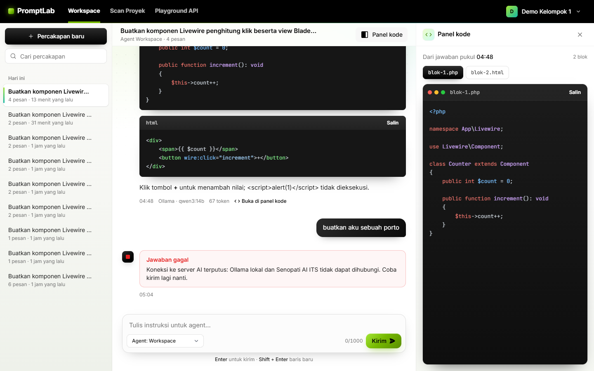
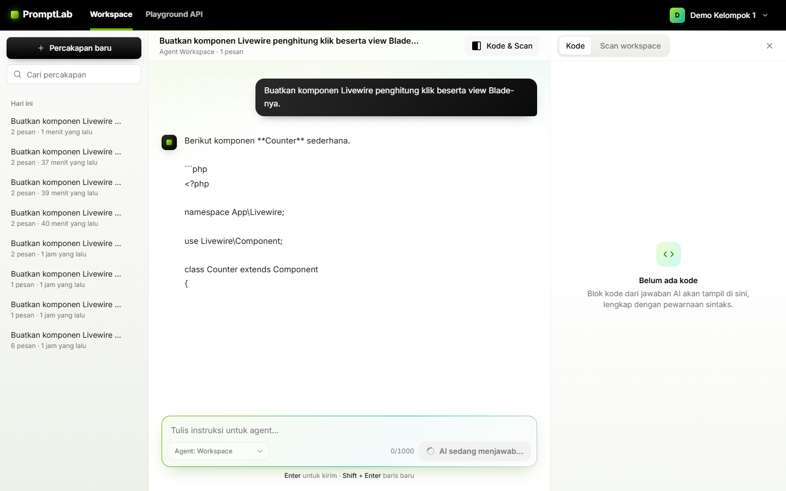
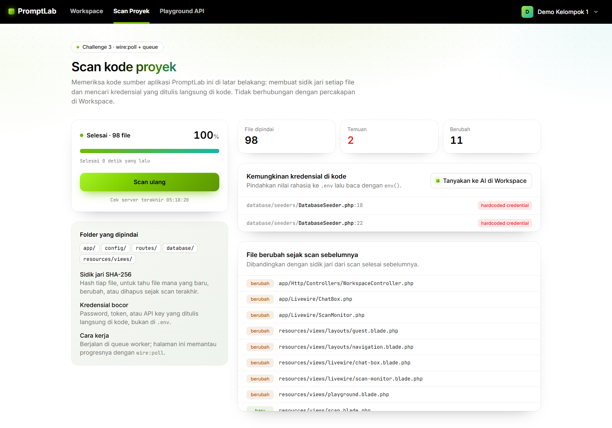
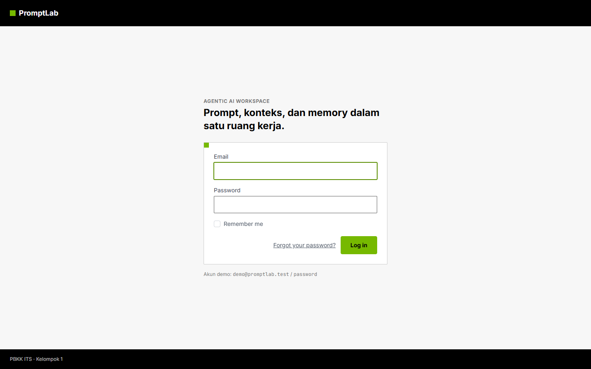
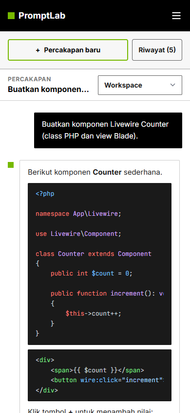
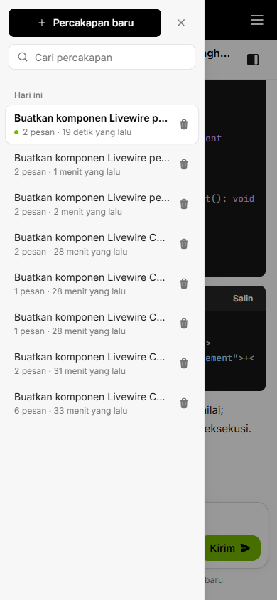
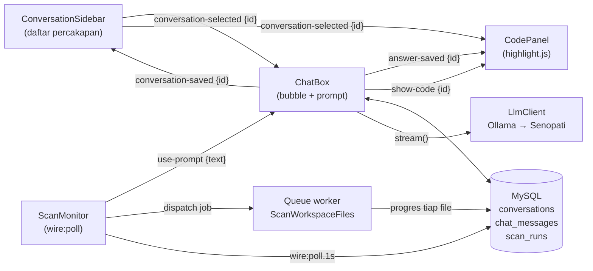
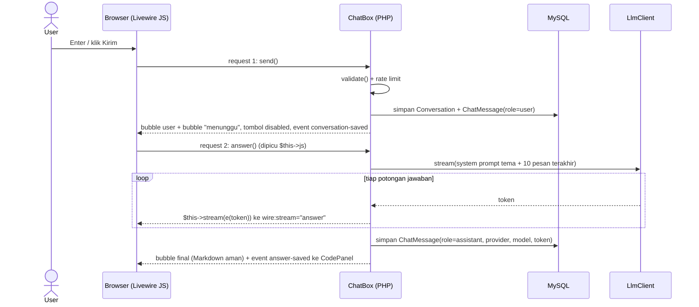

# PromptLab — Tugas 11 & 12 PBKK: Secure LLM API Hub + Livewire Agentic AI Workspace

**PromptLab** adalah final project platform Agentic AI **Kelompok 1** ("Local-first Agentic Prompt, Context & Memory
Optimization"). Repositori ini berisi dua tahap:

- **Pertemuan 12 — Secure & Reactive AI Chat Hub (Livewire).** Workspace split-panel di `/workspace`: daftar
  percakapan, chat box dengan jawaban AI yang mengalir kata demi kata, panel kode dengan pewarnaan sintaks, dan monitor
  scan file latar belakang. Login sesi lewat **Breeze**, riwayat tersimpan di **MySQL** (model `ChatMessage`).
- **Pertemuan 11 — Secure LLM Chat API Hub.** API JSON terproteksi token **Sanctum** (`/api/chat-ai`), dengan halaman
  **Playground API** di `/playground`. Lihat [API Contract](#api-contract).

Workspace dan Playground API memakai **satu login yang sama** (sesi Breeze) dan saling terhubung lewat navigasi atas.
Playground tidak meminta password lagi: token Bearer untuk memanggil `/api/*` dibuat otomatis dari sesi lewat
`POST /playground/token` ([`PlaygroundController`](app/Http/Controllers/PlaygroundController.php)), token playground
lama dicabut setiap kali token baru dibuat, dan tombol *Lihat token (Postman)* menampilkannya untuk dipakai di Postman.
Login API dengan email + password (`POST /api/login`) tetap ada untuk Postman.

Keduanya memakai service yang sama ([`LlmClient`](app/Services/LlmClient.php)): **Ollama lokal** sebagai provider utama
dan **Senopati AI ITS** sebagai fallback otomatis. Desain antarmuka: [`notes/DESIGN.md`](notes/DESIGN.md).



## Pertemuan 12: ketentuan tugas dan implementasinya

| Ketentuan | Implementasi |
|---|---|
| 1. Minimal 2 komponen Livewire yang berinteraksi lewat Events | 4 komponen: [`ConversationSidebar`](app/Livewire/ConversationSidebar.php), [`ChatBox`](app/Livewire/ChatBox.php), [`CodePanel`](app/Livewire/CodePanel.php), [`ScanMonitor`](app/Livewire/ScanMonitor.php). Berkomunikasi hanya lewat `$this->dispatch()` / `$dispatch()` dan listener `#[On]` (lihat [Alur Livewire](#alur-livewire)) |
| 2. Panel hanya untuk user login (Breeze), state terikat `user_id` | Rute `/workspace` di middleware `auth`; login/register/profil dari Breeze. Semua query lewat relasi user yang login ([`OwnsConversations`](app/Livewire/Concerns/OwnsConversations.php)), jadi id milik orang lain → 404. Properti id ditandai `#[Locked]` agar tidak bisa diubah dari browser |
| 3. `wire:loading` pada tombol submit, cegah klik ganda | Tombol kirim: `wire:loading.attr="disabled"` + `@disabled($waiting)` selama AI menjawab, plus pengaman di server (`send()` diabaikan saat `$waiting`) |
| 4. Prompt & respons AI tersimpan berurutan di MySQL, model `ChatMessage` | Tabel `conversations` + `chat_messages` ([migrasi](database/migrations/2026_11_26_090100_create_chat_messages_table.php), [`ChatMessage`](app/Models/ChatMessage.php)). Pesan user disimpan **sebelum** LLM dipanggil; jawaban (berhasil maupun gagal) disimpan setelahnya |
| Validasi `$rules` + pesan bahasa Indonesia | `rules()` / `messages()` di `ChatBox`: wajib, min 3, maks 1000 karakter |
| Lifecycle hooks | `mount()` membuka percakapan terakhir setelah refresh; `updatedPrompt()` memperbarui sisa karakter dan memvalidasi saat mengetik; `updatedTheme()` menyimpan tema ke percakapan |
| **Challenge 1:** animasi pengetikan bertahap | Streaming sungguhan, bukan simulasi: `answer()` membaca SSE dari LLM dan meneruskan tiap potongan ke browser dengan `$this->stream()` → `wire:stream="answer"`, lengkap dengan caret berkedip |
| **Challenge 2:** split-panel code visualizer + syntax highlighting | `CodePanel` mendeteksi blok kode berpagar (```` ```php ... ``` ````) di jawaban, satu tab per blok, diwarnai **highlight.js**, ada tombol salin; blok kode di dalam bubble chat juga diwarnai |
| **Challenge 3:** `wire:poll` + progress bar | `ScanMonitor` menjalankan job queue [`ScanWorkspaceFiles`](app/Jobs/ScanWorkspaceFiles.php): hash SHA-256 tiap file, cari kredensial yang ditulis langsung di kode, dan bandingkan dengan scan sebelumnya. `wire:poll.1s` hanya dipasang selama scan berjalan |
| `.env` dan `vendor/` tidak ikut Git | `.gitignore` |

Tambahan: pencarian percakapan (`wire:model.live.debounce`), hapus percakapan (`wire:confirm`), tema agent per
percakapan, 10 pesan terakhir dikirim ke model sebagai konteks (chat multi-turn), batas 20 pesan/menit per user, dan
tombol "Tanyakan temuan ini ke AI" yang mengirim hasil scan ke chat box lewat event.

### Tangkapan layar

| Jawaban mengalir (Challenge 1) | Selesai: kode berwarna + hasil scan (Challenge 2 & 3) |
|---|---|
|  |  |

| Login (Breeze) | Mobile | Mobile: laci riwayat |
|---|---|---|
|  |  |  |

> Tangkapan layar diambil dengan server LLM uji lokal yang meniru format streaming Ollama, karena Ollama dan Senopati
> tidak terjangkau dari mesin pengambil gambar. Alur Livewire, database, dan tampilan yang terlihat adalah aplikasi asli.

## Alur Livewire

Halaman `/workspace` ([`workspace.blade.php`](resources/views/workspace.blade.php)) berisi empat komponen terpisah.
Tidak ada komponen yang memanggil komponen lain secara langsung; semuanya lewat event.



**Satu kali kirim prompt = dua request Livewire**, supaya bubble user langsung tampil sebelum AI selesai berpikir:



Catatan keamanan:
- Potongan stream di-escape dengan `e()` karena `wire:stream` menyisipkan HTML. Jawaban yang tersimpan dirender dari
  Markdown dengan `html_input: escape` ([`Markdown`](app/Support/Markdown.php)), jadi `<script>` dari model tampil
  sebagai teks biasa.
- Scanner hanya membaca folder tetap di [`config/scan.php`](config/scan.php). User tidak pernah mengirim path atau
  perintah shell, sehingga tidak ada celah *command injection* maupun *path traversal*.
- Kalau Ollama dan Senopati sama-sama gagal, jawaban disimpan dengan status `failed` dan bubble merah menjelaskan
  gangguannya; aplikasi tidak crash.

### Pemetaan rubrik Pertemuan 12

| Kriteria (bobot) | Bukti |
|---|---|
| Desain & UI chat (30%) | Split-panel 3 kolom (riwayat / chat / inspector bertab Kode & Scan yang bisa ditutup), kolom chat terpusat, composer berbentuk kartu, riwayat dikelompokkan per waktu; di layar kecil riwayat dan inspector menjadi laci geser, tanpa scroll horizontal sampai 390 px |
| Proteksi UX loading (20%) | `wire:loading.attr="disabled"` + `@disabled($waiting)` + guard server; test `test_second_send_while_waiting_is_ignored` |
| Integritas DB & riwayat (20%) | `conversations` / `chat_messages` terikat `user_id`; test `test_conversations_of_another_user_cannot_be_opened`, `test_conversation_id_cannot_be_changed_from_the_browser` |
| Konektivitas API LLM (10%) | Streaming + fallback Ollama → Senopati dalam `try/catch`; test `test_falls_back_to_senopati_when_ollama_is_down`, `test_both_providers_down_saves_failed_answer_without_crashing` |
| Eksplorasi challenge A+ (10%) | Ketiga challenge dikerjakan dan diuji (lihat tabel di atas) |
| PSR-12 & demo (10%) | `./vendor/bin/pint --test` lulus; 60 test lulus |

## Instalasi

**Sekali saja (pertama kali clone):**

```bash
composer install
npm install
php -r "file_exists('.env') || copy('.env.example', '.env');"   # hanya menyalin bila .env belum ada
php artisan key:generate
```

Buat database MySQL (lewat phpMyAdmin/XAMPP atau `mysql -u root -p`):

```sql
CREATE DATABASE promptlab CHARACTER SET utf8mb4 COLLATE utf8mb4_unicode_ci;
```

Isi koneksinya di `.env`:

```dotenv
DB_CONNECTION=mysql
DB_HOST=127.0.0.1
DB_PORT=3306
DB_DATABASE=promptlab
DB_USERNAME=root
DB_PASSWORD=password-mysql-anda
```

Lalu:

```bash
php artisan migrate --seed        # semua tabel + akun demo
npm run build                     # CSS/JS (Tailwind, highlight.js)
```

Isi juga token Senopati dan `OLLAMA_MODEL` di `.env` (lihat di bawah).

**Setiap kali menjalankan** (dua terminal):

```bash
php artisan serve                 # http://127.0.0.1:8000 → login → /workspace
php artisan queue:work            # wajib untuk fitur "Scan workspace" (Challenge 3)
```

Atau satu perintah: `composer run dev` (server, queue, log, dan Vite sekaligus).

> **Jangan** menjalankan `cp .env.example .env` setelah `.env` diisi. `.env.example` sengaja berisi
> nilai kosong karena ikut Git, jadi perintah itu menimpa token dan `OLLAMA_MODEL` Anda. Setelah `git pull`, cukup
> `composer install` / `npm install` (bila ada paket baru), `php artisan migrate`, dan `npm run build`. Variabel baru
> di `.env.example` disalin manual.

**Provider utama: Ollama lokal (Challenge 3).** Jalankan Ollama dan isi `OLLAMA_MODEL` dengan model dari `ollama list`
(model 7B kuantisasi Q4 muat di GPU 6 GB):

```bash
sudo systemctl start ollama        # bila Ollama terpasang sebagai service; atau: ollama serve
ollama list                        # pilih nama model untuk OLLAMA_MODEL
ollama run NAMA_MODEL "halo"       # "pemanasan": memuat model ke GPU sebelum demo
```

Pemanasan penting: model yang belum dimuat butuh ±40 detik (*cold start*) pada jawaban pertama, dan Ollama melepas
model dari GPU setelah 5 menit tidak dipakai.

**Cadangan: Senopati AI ITS.** Dipakai otomatis bila Ollama mati. Isi token milik Anda di `.env` (file ini tidak pernah
ikut Git):

```dotenv
SENOPATI_API_KEY=token-dari-its
```

Cek token langsung ke gateway, tanpa lewat Laravel. Ganti `TOKEN_ANDA`; balasan JSON berisi `choices` berarti
token valid:

```bash
curl https://senopati.its.ac.id/llm-gateway/v1/chat/completions \
  -H "Authorization: Bearer TOKEN_ANDA" -H "Content-Type: application/json" \
  -d '{"model":"qwen3:14b","messages":[{"role":"user","content":"halo"}]}'
```

Akun demo: `demo@promptlab.test` / `password`.

### Variabel `.env`

| Variabel | Default | Arti |
|---|---|---|
| `LLM_PROVIDER_ORDER` | `ollama,senopati` | urutan provider; yang berikutnya = fallback |
| `LLM_TIMEOUT` | `60` | detik per request ke LLM |
| `LLM_RETRIES` | `3` | percobaan per provider (hanya untuk koneksi putus / HTTP 5xx; timeout tidak diulang) |
| `LLM_TEMPERATURE` | `0.7` | kreativitas jawaban |
| `LLM_THINK` | `false` | mode berpikir `qwen3`; `false` = jawaban jauh lebih cepat dan kata pertama streaming langsung muncul |
| `SENOPATI_BASE_URL` | `https://senopati.its.ac.id/llm-gateway/v1` | gateway LLM kampus, format Chat Completion OpenAI |
| `SENOPATI_MODEL` | `qwen3:14b` | model di gateway Senopati |
| `SENOPATI_API_KEY` | kosong | token ITS untuk fallback; dikirim sebagai `Authorization: Bearer` |
| `OLLAMA_BASE_URL` | `http://localhost:11434/v1` | endpoint OpenAI-compatible bawaan Ollama |
| `OLLAMA_MODEL` | `qwen3:14b` | **harus** model yang ada di `ollama list` (mis. `deephat:latest`) |
| `SANCTUM_EXPIRATION` | `1440` | umur token (menit) |
| `DB_CONNECTION` … `DB_PASSWORD` | `mysql`, `promptlab` | database MySQL untuk riwayat chat workspace |
| `SCAN_DELAY_MS` | `120` | jeda per file saat scan agar progress bar terlihat; `0` = secepatnya |

**Kalau `/api/chat-ai` menjawab 503**, berarti Ollama **dan** Senopati sama-sama gagal. Lihat `attempts` di respons
(atau "Jalur provider" di playground) dan `storage/logs/laravel.log`:
- `ollama gagal: tidak dapat dihubungi`: Ollama belum menyala (`sudo systemctl start ollama`).
- `senopati gagal: HTTP 401` / `Authentication Error`: `SENOPATI_API_KEY` kosong atau salah (tidak di-retry).
- `timeout 60 s` / `cURL error 6/7/28`: server tidak terjangkau atau terlalu lama menjawab.

## API Contract

Base URL: `http://127.0.0.1:8000/api`. Semua request mengirim `Accept: application/json` dan
`Content-Type: application/json`. Endpoint bertanda 🔒 wajib `Authorization: Bearer <token>`; tanpa token (atau token
kedaluwarsa/dicabut) responsnya **401** `{"message": "Unauthenticated."}`.

### `POST /login`
Tukar email + password dengan token. Dibatasi 6 request/menit.

```json
// Request
{ "email": "demo@promptlab.test", "password": "password", "device_name": "postman" }

// 200 OK (token hanya tampil sekali; server menyimpan hash SHA-256-nya)
{
  "status": "success",
  "access_token": "1|abc123...",
  "token_type": "Bearer",
  "expires_at": "2026-11-12 09:30:00",
  "user": { "id": 1, "name": "Demo Kelompok 1", "email": "demo@promptlab.test" }
}

// 401
{ "status": "error", "message": "Kredensial salah." }
```

### 🔒 `POST /chat-ai`
Kirim prompt, tunggu jawaban lengkap. Dibatasi 20 request/menit per user.

| Field | Tipe | Aturan |
|---|---|---|
| `prompt` | string | wajib, maks 1000 karakter |
| `theme` | string | opsional: `default` (bawaan), `prompt_engineer`, `context_engineer`, `evaluator` |
| `think` | boolean | opsional: mode berpikir `qwen3` untuk request ini; bila tidak dikirim, ikut `LLM_THINK` |
| `simulate_primary_down` | boolean | opsional, **hanya berlaku bila `APP_DEBUG=true`**: provider pertama dibuat gagal untuk menguji fallback |

```json
// Request
{ "prompt": "Jelaskan middleware!", "theme": "default" }

// 201 Created
{
  "status": "success",
  "data": {
    "session_id": 12,
    "status": "success",
    "provider": "ollama",
    "model_used": "deephat:latest",
    "think": false,
    "theme": "default",
    "prompt": "Jelaskan middleware!",
    "ai_response": "Middleware adalah...",
    "tokens": { "prompt": 30, "completion": 120, "total": 150 },
    "timestamp": "2026-08-28 09:30:00"
  },
  "attempts": [
    { "provider": "ollama", "ok": true, "reason": null }
  ]
}

// 201 Created setelah fallback: data.provider = "senopati", data.model_used = "qwen3:14b", dan
"attempts": [
  { "provider": "ollama", "ok": false, "reason": "tidak dapat dihubungi" },
  { "provider": "senopati", "ok": true, "reason": null }
]

// 422 Unprocessable Content
{ "message": "Prompt maksimal 1000 karakter.", "errors": { "prompt": ["Prompt maksimal 1000 karakter."] } }

// 503 Service Unavailable (semua provider gagal; tetap dicatat dengan status "failed")
{ "status": "error", "message": "Semua server AI tidak dapat dihubungi. Coba lagi nanti." }
```

### 🔒 `POST /chat-ai/stream`
Body sama dengan `/chat-ai`. Respons `Content-Type: text/event-stream` berisi event berikut:

```text
event: attempt
data: {"provider":"ollama","ok":true,"reason":null}

event: thinking
data: {"thinking":true}

event: token
data: {"delta":"Middleware "}

event: token
data: {"delta":"adalah "}

event: done
data: {"status":"success","data":{ ...sama dengan data /chat-ai... }}
```

`thinking` hanya dikirim **sekali**, dan hanya bila `think: true`, saat model mulai menalar. Isi penalarannya
(`reasoning_content` dari gateway) **tidak pernah** diteruskan ke klien maupun disimpan.
Bila gagal: `event: error` `data: {"status":"error","message":"Streaming gagal. Coba lagi nanti."}`.
Fallback (bila diaktifkan) hanya terjadi **sebelum** token pertama keluar; teks yang sudah terkirim tidak bisa ditarik.
Validasi (422) dan auth (401) tetap dijawab JSON biasa sebelum stream dibuka.

### 🔒 `GET /chat-ai/history`
Riwayat milik user yang login saja, terbaru dulu, 10 per halaman (`?page=2`).

```json
{
  "data": [ { "session_id": 12, "status": "success", "model_used": "qwen3:14b", "...": "..." } ],
  "links": { "first": "...", "last": "...", "prev": null, "next": null },
  "meta": { "current_page": 1, "per_page": 10, "total": 1 },
  "status": "success"
}
```

### 🔒 `GET /user` · 🔒 `POST /logout`
`/user` mengembalikan profil pemilik token. `/logout` mencabut **hanya token yang sedang dipakai**
(perangkat lain tetap login) → `{"status":"success","message":"Token dicabut."}`.

## Tema agent PromptLab

System prompt dipilih lewat field `theme` dan disisipkan sebagai pesan `system` pertama
([`config/llm.php`](config/llm.php)). Keempat tema mengikuti alur PromptLab *Ask → Context → Act → Evaluate*.

| `theme` | Peran di PromptLab | Perilaku yang diminta dari model |
|---|---|---|
| `default` | Workspace | Menjawab ringkas, tidak mengarang endpoint/file, menyebut info yang kurang |
| `prompt_engineer` | Prompt Engineering | Menandai bagian ambigu dan constraint yang hilang; saran prompt **hanya bila perlu** |
| `context_engineer` | Context Engineering | Memilih informasi/file yang relevan untuk model beserta alasannya |
| `evaluator` | Evaluation | Membandingkan baseline A vs kandidat B; benar dulu, baru hemat |

Menambah tema cukup dengan menambah satu entri di `themes`. Validasi `ChatAiRequest` dan dropdown playground membaca
daftar yang sama, jadi ikut berubah otomatis.

## Skema `chat_logs`

| Kolom | Tipe | Catatan |
|---|---|---|
| `id` | bigint | tampil sebagai `session_id` |
| `user_id` | FK → `users` | `cascadeOnDelete` |
| `theme` | string(50) | tema system prompt |
| `provider` / `model` | string, nullable | null bila semua provider gagal |
| `think` | boolean | mode berpikir yang dipakai (migrasi `add_think_to_chat_logs_table`) |
| `prompt` / `response` | text / longText | `response` null bila gagal total |
| `status` | string(10) | `success` / `failed` |
| `prompt_tokens` / `completion_tokens` / `total_tokens` | unsigned int, nullable | dari field `usage` LLM |
| `created_at` / `updated_at` | timestamp | indeks `(user_id, created_at)` untuk riwayat |

## Alur fallback (Challenge 3 Pertemuan 11)

1. Coba provider pertama (`ollama`, lokal). Koneksi putus atau HTTP 5xx → ulangi sampai `LLM_RETRIES` kali (jeda 200 ms).
   - Error 4xx (mis. token salah) **tidak** diulang karena hasilnya akan sama.
   - Timeout **tidak** diulang: satu percobaan sudah memakai seluruh `LLM_TIMEOUT`, jadi mengulang hanya melipatgandakan
     waktu tunggu. Langsung pindah ke provider berikutnya.
2. Masih gagal → catat pesan lengkap di `storage/logs/laravel.log`, lanjut ke provider berikutnya (`senopati`).
3. Semua gagal → HTTP 503 + baris log `status = failed`.

Setiap percobaan dilaporkan sebagai `attempts` (`/chat-ai`) atau event `attempt` (`/chat-ai/stream`, terkirim sebelum
jawaban mulai mengalir). Alasan yang dikirim ke klien sengaja singkat: `HTTP 401`, `timeout 60 s`,
`tidak dapat dihubungi`, `disimulasikan mati`. Pesan error mentah hanya ada di log.

**Menguji di playground** (`APP_DEBUG=true`): pilih *Uji fallback → Simulasikan Ollama mati*. Provider pertama dibuat
gagal **sebelum** request dikirim, lalu jalur fallback yang sebenarnya berjalan. Di bawah jawaban tampil
`JALUR PROVIDER  OLLAMA GAGAL: DISIMULASIKAN MATI → SENOPATI BERHASIL`, dan kolom Provider di riwayat berisi
`senopati`. Versi nyata tanpa simulasi: `sudo systemctl stop ollama`, kirim prompt, lalu nyalakan lagi.
Saat `APP_DEBUG=false` tombol ini tidak tampil dan field `simulate_primary_down` diabaikan API.

**Bukti gangguan nyata (2026-11-17):** mekanisme ini sudah menyelamatkan request sungguhan. Saat itu urutannya masih
terbalik (Senopati → Ollama): gateway Senopati menggantung, dan setelah 60 detik Ollama mengambil alih
(`SENOPATI GAGAL: TIMEOUT 60 S → OLLAMA BERHASIL`). Kode fallback tidak bergantung pada urutan provider, jadi perilaku
yang sama berlaku untuk urutan Ollama → Senopati sekarang.

## Skema workspace (Pertemuan 12)

| Tabel | Kolom penting | Catatan |
|---|---|---|
| `conversations` | `user_id`, `title`, `theme`, `updated_at` | satu baris = satu item di sidebar; indeks `(user_id, updated_at)` |
| `chat_messages` | `conversation_id`, `user_id`, `role` (`user`/`assistant`), `content`, `status`, `provider`, `model`, `total_tokens` | urutan = `id` auto-increment; `user_id` ikut disimpan agar setiap query bisa dibatasi ke pemiliknya; `cascadeOnDelete` dari percakapan dan user |
| `scan_runs` | `user_id`, `status`, `total`, `processed`, `current_file`, `hashes` (JSON), `findings` (JSON), `changed` (JSON) | ditulis job queue setiap selesai satu file, dibaca `ScanMonitor` lewat `wire:poll` |

Tabel `chat_logs` (Pertemuan 11) tetap dipakai oleh API `/api/chat-ai`.

## Test dan standar kode

```bash
php artisan test          # 60 test
./vendor/bin/pint --test  # PSR-12 (pint.json)
```

- [`tests/Feature/WorkspaceTest.php`](tests/Feature/WorkspaceTest.php) (Pertemuan 12): guest diarahkan ke login,
  keempat komponen tampil, kirim → bubble user tersimpan sebelum LLM dipanggil → jawaban di-stream ter-escape dan
  tersimpan, konteks multi-turn, validasi + penghitung karakter, klik ganda diabaikan, fallback Ollama → Senopati,
  semua provider mati tanpa crash, percakapan user lain → 404, properti `#[Locked]`, event antar komponen, panel kode,
  `wire:poll` hanya saat scan aktif, job scan (hash, temuan, perubahan file).
- [`tests/Feature/ChatAiApiTest.php`](tests/Feature/ChatAiApiTest.php) (Pertemuan 11): auth token, validasi, log DB,
  tema, think, fallback, SSE, riwayat.
- [`tests/Feature/PlaygroundTest.php`](tests/Feature/PlaygroundTest.php): playground butuh login sesi yang sama, ada tautan kembali ke workspace, token dari sesi berfungsi di API dan token lama dicabut.
- `tests/Feature/Auth/*`, `ProfileTest.php`: bawaan Breeze.

LLM dipalsukan dengan `Http::fake()`, jadi test tidak butuh Ollama, token Senopati, maupun internet. Test memakai
SQLite in-memory (`phpunit.xml`), terpisah dari database MySQL utama.

## Demo workspace (pitching 5 menit, Pertemuan 13)

1. Buka `/workspace` tanpa login → diarahkan ke halaman login Breeze. Masuk dengan akun demo.
2. Klik salah satu contoh prompt (mis. "Buatkan komponen Livewire penghitung klik…") → Enter. Tunjukkan bubble user
   langsung muncul, tombol berubah "AI sedang menjawab…" dan terkunci, lalu jawaban mengalir kata demi kata.
3. Panel kode kanan otomatis menampilkan blok kode berwarna, satu tab per blok; tombol **Salin**.
4. Ganti agent ke *Prompt Engineer*, kirim prompt ambigu → jawaban mengikuti system prompt tema itu.
5. **Percakapan baru**, lalu klik percakapan lama di sidebar → riwayat kembali dari MySQL. Refresh halaman → percakapan
   terakhir terbuka lagi (`mount()`).
6. Ketik lebih dari 1000 karakter → sisa karakter merah + pesan error sebelum dikirim (`updatedPrompt()`).
7. **Mulai scan** → progress bar bergerak lewat `wire:poll.1s`; setelah selesai, tunjukkan temuan kredensial dan klik
   "Tanyakan temuan ini ke AI" (event `use-prompt` ke chat box).
8. Login sebagai akun kedua (register) → sidebar kosong: riwayat terikat ke `user_id`.

## Pemetaan rubrik Pertemuan 11

| Komponen (bobot) | Bukti |
|---|---|
| Fungsionalitas & koneksi LLM (40%) | `/api/chat-ai`, `LlmClient`, test `chat_returns_resource_and_logs_to_database` |
| Autentikasi & validasi Sanctum (20%) | `auth:sanctum`, `ChatAiRequest`, test `chat_requires_token...`, `prompt_is_validated` |
| Logging & riwayat DB (20%) | `chat_logs`, `/api/chat-ai/history`, sukses dan gagal sama-sama dicatat |
| Challenge A+ (10%) | streaming SSE, 4 tema system prompt, fallback otomatis Ollama lokal → Senopati ITS (sesuai soal, teruji) |
| Kerapian kode (10%) | Pint PSR-12, satu service untuk semua provider, komentar per fungsi |

## Demo Postman API (Pertemuan 11)

1. `POST /api/chat-ai` **tanpa** token → 401.
2. `POST /api/login` → salin `access_token` ke tab *Authorization → Bearer Token*.
3. `POST /api/chat-ai` dengan prompt 1001 karakter → 422.
4. `POST /api/chat-ai` dengan `theme: prompt_engineer` dan prompt yang sengaja ambigu
   (mis. "Dokumentasikan API login") → 201 + JSON berisi analisis dan saran prompt.
5. `POST /api/chat-ai/stream` → event mengalir satu per satu.
6. Fallback: kirim `"simulate_primary_down": true` (atau di playground pilih *Simulasikan Ollama mati*) →
   `data.provider: senopati` dan `attempts` menunjukkan Ollama gagal → Senopati berhasil. Versi nyata:
   `sudo systemctl stop ollama` (alasan `tidak dapat dihubungi`). Kosongkan juga `SENOPATI_API_KEY` → 503 + log `failed`.
7. `GET /api/chat-ai/history` → semua percobaan tercatat.
